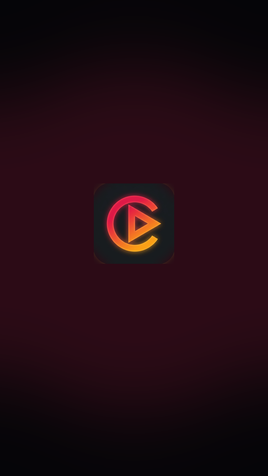
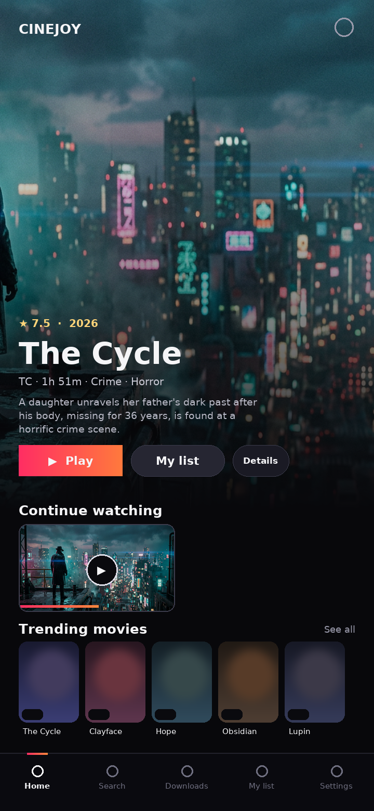
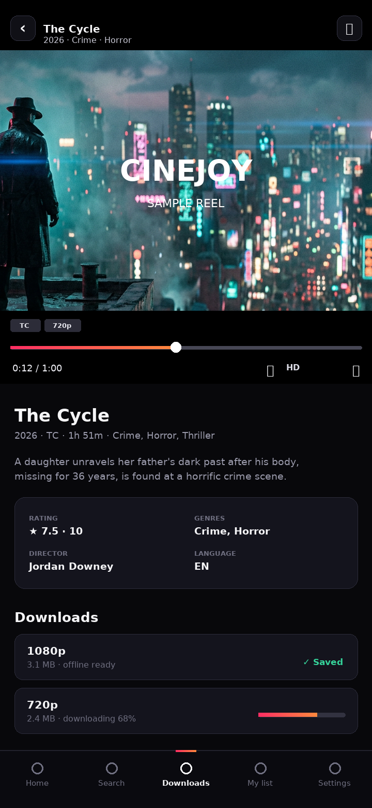
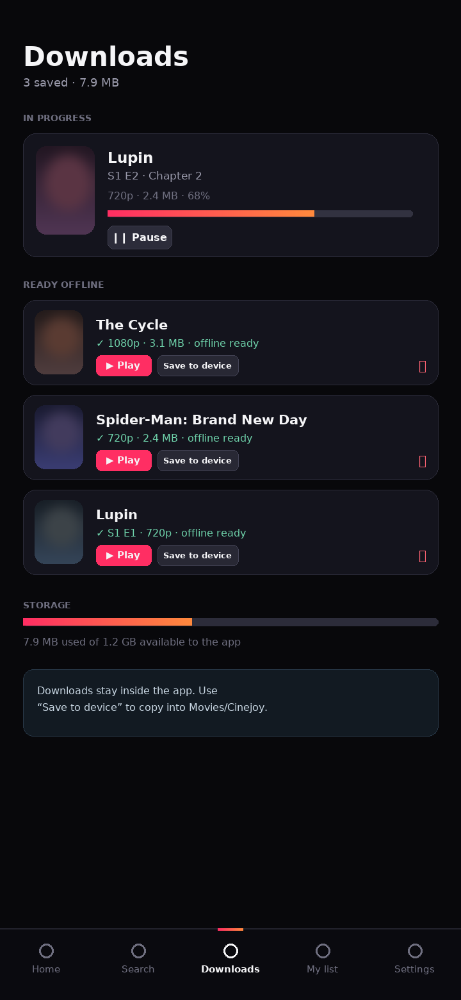

# Cinejoy — movies & series for Android

A mobile app version of [cinejoy.pk](https://cinejoy.pk): browse and search
movies and series, stream episodes in a native-feeling player, and **download
titles to watch offline**.

The same codebase ships three ways:

| Target | What you get | How |
| --- | --- | --- |
| **Android app** | Signed-free APK, installs on any phone running Android 7+ | GitHub Actions → `cinejoy-apk` artifact (see below) |
| **Installable PWA** | Add to home screen, offline shell, real downloads | open the built site in Chrome |
| **Local dev** | hot reload + companion scraping API | `npm run dev` |

<p align="center">
  
  
  
  
</p>

---

## What it does

**Catalog** — a poster grid for movies and series, hero spotlight, "browse by
provider", new releases, top rated, genre chips and instant search across
titles, cast and genres. Ships with 40+ real titles (metadata and artwork from
TMDB, exactly as shown on cinejoy.pk) so the app is useful with no backend.

**Player** — full-screen HLS/mp4 playback with
* adaptive quality via [hls.js](https://github.com/video-dev/hls.js) plus a manual
  quality picker (Auto / 720p / 540p / 360p on the bundled stream),
* gesture controls: drag horizontally to scrub (with a time HUD), drag on the
  right half for volume, left half for brightness, double-tap either side to
  skip ±10 s, single tap to toggle chrome,
* resume from where you left off (positions saved every 5 s, per episode),
* autoplay-next countdown, "up next" episode switching, landscape fullscreen
  with an orientation lock, screen-awake while playing,
* graceful error surface with *Retry* / *Switch source* / *Open in another
  player* (hands the stream to the Android system player).

**Downloads** — a real download manager, not a fake progress bar:
* fetch into IndexedDB with streamed progress, pause / resume / retry / delete,
* queue with two concurrent transfers, survives app restarts,
* finished files play straight from local storage (no data used, works in
  airplane mode) and are marked "Offline" in the app,
* **Save to device** writes the file to `Movies/Cinejoy` on Android (via
  Capacitor Filesystem) or to your downloads folder on the web,
* storage usage readout from the browser/WebView quota.

**Library** — watchlist, continue-watching with progress bars, full history with
resume points, and an offline tab.

**Settings** — live-feed toggle, API base URL, default quality, autoplay, data
saver, Wi-Fi-only downloads, one-tap "clear all data", app version.

Everything is stored locally (IndexedDB + localStorage). No account, no trackers.

---

## Quick start

```bash
cd app
npm install
npm run dev            # http://localhost:5173  (mobile viewport recommended)
```

Optional — run the companion API in a second shell so the app can pull the
**live** cinejoy.pk catalog instead of the bundled one:

```bash
node server/index.mjs  # http://localhost:8787, Vite proxies /api to it
```

The app detects the API automatically and silently falls back to the bundled
catalog when it is unreachable, so the UI is never blocked on the network.

### Get the APK without a toolchain

1. Open **Actions → Android APK** on this repository and pick the newest green run.
2. Download the **`cinejoy-apk`** artifact (≈29 MB) and unzip it → `cinejoy.apk`.
3. Copy it to your phone and tap it (allow "install unknown apps" for your file
   manager). Android 7+ is supported.

Pushing a tag (`git tag v1.0.0 && git push --tags`) also attaches that same APK
to a GitHub **Release**, which is the friendliest way to share it.

### Build the APK yourself

```bash
cd app
npm run build          # type-check + bundle to dist/
npx cap sync android   # copy dist/ into the native project
cd android && ./gradlew assembleDebug
# → app/build/outputs/apk/debug/app-debug.apk
```

You need JDK 21 and the Android SDK (`ANDROID_HOME`). The CI job does exactly
this on every push, so use the artifact if you don't have a local toolchain.

The workflow (`.github/workflows/android.yml`) runs type-check, the unit tests,
both test suites and the Gradle build on every push, uploads `cinejoy-apk`, and
attaches the APK to a GitHub Release when you push a `v*` tag.

---

## Project layout

```
app/                      the application (React 19 + TypeScript + Vite)
├─ src/
│  ├─ App.tsx             routes + bottom tab bar
│  ├─ pages/
│  │  ├─ Home.tsx         hero, rows, continue watching, providers
│  │  ├─ Search.tsx       instant search, filters, genres, recents
│  │  ├─ TitleDetail.tsx  synopsis, cast, seasons, download sheet
│  │  ├─ Watch.tsx        the player (gestures, HLS, quality, autoplay)
│  │  ├─ Downloads.tsx    queue, progress, offline playback, export
│  │  ├─ Library.tsx      my list / history / offline
│  │  ├─ Browse.tsx       full-grid category pages
│  │  └─ Settings.tsx     feed, playback, downloads, data
│  ├─ lib/
│  │  ├─ catalog.ts       bundled catalog (real TMDB ids/posters)
│  │  ├─ api.ts           live feed loader + search/similar/trending helpers
│  │  ├─ store.tsx        app state, download manager, history, watchlist
│  │  ├─ db.ts            IndexedDB (video blobs, downloads, history)
│  │  ├─ platform.ts      Capacitor bridge with web fallbacks
│  │  └─ types.ts
│  └─ test/               vitest + jsdom UI tests
├─ public/media/          bundled demo streams (generated, see tools/)
├─ public/icons/          app icons + manifest
├─ android/               Capacitor native project (Gradle)
└─ tools/                 asset generators (icons, splash, sample video)

server/                   companion API — scrapes cinejoy.pk, zero deps
├─ index.mjs              HTTP server: /api/catalog /api/title /api/sources
├─ scraper.mjs            Next.js payload / anchor / title-page readers
└─ test/scraper.test.mjs  offline fixtures for every parser branch

.github/workflows/        APK build + web build/test
```

---

## The live catalog

`server/` is a small scraper + cache around cinejoy.pk. It reads the public
metadata that the site already renders (Next.js payload, anchors, title pages)
and normalises it to the app's `Title` shape:

```
GET /api/health                        → cache + upstream status
GET /api/catalog?limit=160             → { items, origin, fetchedAt }
GET /api/title/1290418                 → one title, with cast/episodes/sources
GET /api/search?q=lupin                → filtered items
GET /api/sources/movie/1290418         → stream URLs referenced by the page
```

* 15-minute catalog cache, 30-minute per-title cache, in-flight de-duplication.
* Stream URLs are only ever *reported* when the page itself references a direct
  `.m3u8`/`.mp4`; the site's embedded player is not bypassed. When only an
  iframe exists the app keeps its own bundled source, and the player's "Open in
  another player" hands playback to the device.
* The parser never assumes one page shape — it tries the JSON payload, then the
  RSC flight stream, then anchor markup, and the tests cover each path.

> Hosting note: run the API anywhere Node 20+ runs. Point the app at it with
> **Settings → API base URL** (or leave it blank if the API serves the built app
> from `app/dist` — it does, with the right MIME types and byte-range support for
> video).

---

## Bundled media

`public/media` is generated, not downloaded — so the repo never hotlinks a
third-party CDN and playback/downloads work with no network:

```bash
pip install pillow imageio-ffmpeg          # anything that provides ffmpeg
python3 app/tools/make-sample-media.py     # streams, HLS ladder, poster, icons
python3 app/tools/make-android-assets.py   # launcher icons + splash screens
```

It renders a Ken-Burns clip from a still, muxes a quiet tone track, burns in a
"sample reel" card and a drifting watermark (so you can see it is really
playing), then builds a 3-rendition HLS ladder with ffmpeg.

---

## Tests

```bash
cd app && npm run typecheck && npx vitest run     # 21 UI/integration tests
node --test server/test/scraper.test.mjs          # 7 parser tests
```

The UI suite renders the real app in jsdom: home rows from the bundled catalog,
search filtering, title details with cast/episodes, the player's download sheet
and quality controls, settings, and an offline-everything case (fetch and
IndexedDB unavailable) to prove the app still boots. A second suite drives the
download manager end to end against a mocked stream — completed file written to
IndexedDB, failure reasons, HLS rejection, blob cleanup on delete, resume points
and My List — using `fake-indexeddb`.

---

## Legal

Cinejoy is a client for publicly listed catalog metadata. It ships **sample
streams generated for this project** — no copyrighted video is redistributed.
Metadata and artwork belong to TMDB and the respective rights holders. If you
connect the live feed, make sure streaming what you find is lawful where you
are. MIT licensed (see `LICENSE`).
